

# 『嘘つきパレットと剥落の聖女』
### ―異端修復師は神話の塗り潰しを暴く―
*(The Liar's Palette and the Peeling Saint)*

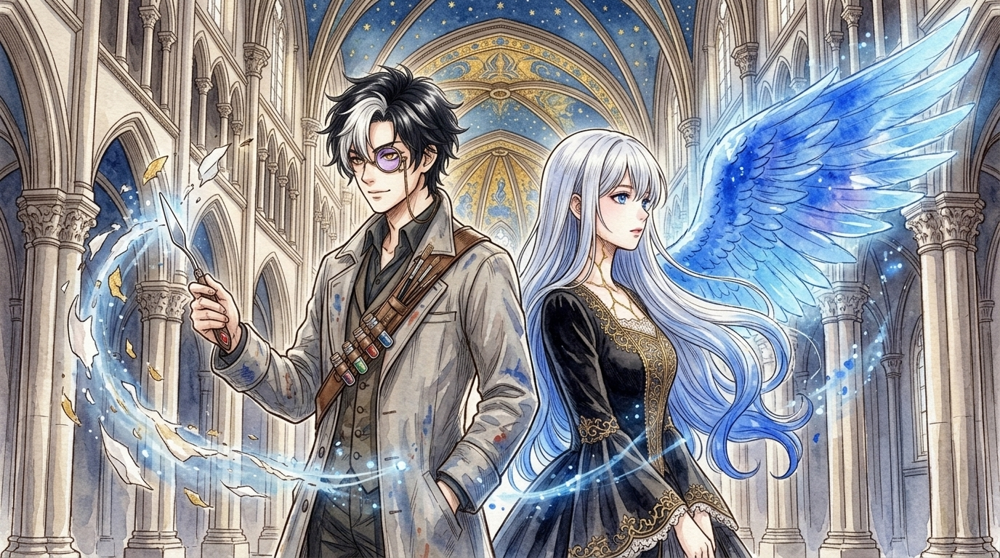

 

**「――その薄っぺらな神話（オーバーペイント）、俺が基底層まで引っぺがしてやるよ」**

[**▶ 今すぐ第1話を読む（`chapters/ch01.md`）**](./chapters/ch01.md) ｜ [**🌍 世界観・修復科学設定**](./notes/world.md) ｜ [**🎭 キャラクター設定表**](./notes/characters.md)

---

## 🤖 プロジェクト概要：AI完全自律アニメ原作小説執筆プロジェクト

本作品および特設サイト（`https://palette.ecolifechallenge.com`）は、**「人間のフィードバックや軌道修正を一切挟まず、AI（Google Antigravity）の独力・完全自律だけで、どこまで面白いアニメ1クール原作小説を創り上げられるか」**に挑んだ実験的プロジェクトです。

1. **アニメ・ラノベ市場調査＆企画自己選出**: 最新トレンド分析から3つの企画候補を立案し、AI自身の自己採点（97/100点）によって本作を選出。
2. **専門知識調査＆世界観構築**: 西洋古典絵画の構造（ボローニャ石膏地・赤土ボーロ・水押し金箔・卵黄テンペラ・油彩）と保存修復科学（顔料の毒性・黒変現象・赤外線リフレクトグラフィ・剥離転写法ストラッポ）を調査し、バトル＆ミステリー体系へ昇華。
3. **全12話（48シーン）詳細設計＆完全自律執筆**: 各話ごとに「執筆 → 6項目の鬼の自己推敲（口調・要約排除・科学描写・伏線整合性） → 直接改稿 → 動的状態シート（`state.md`）の更新」を自律ループで実行し、**全12話・計135,752文字（文庫本換算で約1.5冊分）**の完成原稿を一気通貫で執筆。
4. **公式ビジュアル生成**: 設定資料に基づき、透明水彩・つけペン線画タッチ（v2）およびアニメデジタル彩色タッチ（v1）のキービジュアル＆主要キャラクターイラストを生成。

---

## 📖 INTRODUCTION / あらすじ

> **美しい嘘（オーバーペイント）で塗り固められたこの街で、**
> **俺たちは一番残酷で、一番眩しい「下絵（オリジナル）」に恋をした。**

巨大なカルデラ湖に聳える白亜と黄金の宗教都市・**アルテミシア**。
この街のあらゆる熱と光、そして秩序は、魂と奇跡を定着させた絵画――**『聖骸画（イコン）』**によって支えられていた。

しかし、その華やかな栄光の裏には、国家規模の巨大な欺瞞があった。
聖彩教会は、都合の悪い過去の虐殺や歴史の綻びが描かれた本来の聖画の上から、猛毒の**鉛白（クレムニッツ・ホワイト）**と純金箔を塗り重ね、民衆に都合の良い「偽りの神話」を信じ込ませていたのである。その上塗りを剥がす行為は『剥離異端罪』として即座に火刑に処される。

最下層の貧民窟「灰底街（スフマート）」で闇修復工房『atelier ペンティメント』を営む青年**ルカ・ヴァルツ**は、5年前の公開裁判で最愛の師匠を裏切って生き延びた過去を背負い、「人を救うのは本物なんかじゃない、よく出来た嘘（オーバーペイント）さ」と嘯きながら、鉛と水銀の毒に蝕まれる日々を送っていた。

ある冷たい化学霧の夜。彼の工房へ、教会から盗み出された「黒鉄の特級封印額縁」が運び込まれる。
その棺の中で眠っていたのは、絵画ではなく――ボローニャ石膏のように透き通る白磁の肌と鎖骨に走る金継ぎの亀裂（クラクリュール）を持ち、背中を分厚い**「7層のオーバーペイント」**で塗り潰された少女、**イリス・ラピスラズリ**だった。

異端審問修復庁の業火が工房を包囲したその瞬間、ルカは右目の光学モノクルを起動し、柳葉刀のパレットナイフと混合溶剤で少女の背中の「第1層」へと斬り込む――！

剥がれ落ちる偽りの白。目を覚ます純度100%の真群青（ラピスラズリ）の瞳。
そして少女の背中の第2層の下から浮かび上がったのは、5年前に処刑されたはずのルカの亡き師匠の「固有署名（モノグラム）」だった――。

**なぜ師匠は、彼女の背中を7層もの猛毒で塗り潰したのか？**
**すべてを剥がした最下層（シノピア）に眠る、この世界の「本当の空の色」とは？**

嘘つきな異端修復師と、記憶を塗り潰された毒舌聖女が織りなす、極彩色のコンサベーション・ファンタジー、開幕。

---

## 🎭 CHARACTERS / 登場人物

<table>
  <tr>
    <td width="35%" align="center">
      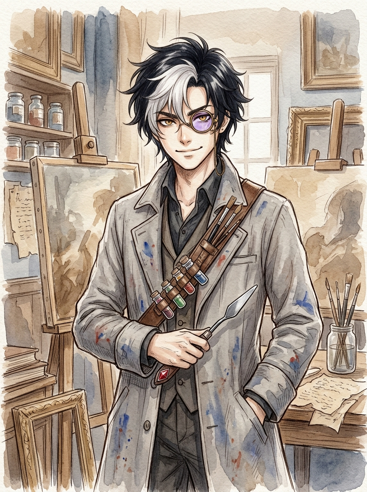
    </td>
    <td width="65%" valign="top">
      <h3>ルカ・ヴァルツ (Luka Waltz)</h3>
      
<b>「――亀裂網（クラクリュール）の角度が不自然だ。その薄っぺらな神話（オーバーペイント）、俺が基底層まで引っぺがしてやるよ」</b>

      <ul>
        <li><b>肩書</b>：灰底街の闇修復師（ブラック・コンサベーター）兼 贋作師 ／ 『atelier ペンティメント』店主（21歳）</li>
        <li><b>武装・能力</b>：多波長光学モノクル（IR/UV切替式）、柳葉刀型パレットナイフ、<b>【絶対層視眼（レイヤー・サイト）】</b>、<b>【超速溶剤調合＆選択的剥離術】</b></li>
        <li><b>人物像</b>：前髪の一部が鉛白で白く脱色した黒髪の青年。普段は金にがめつく軽薄な皮肉屋（「〜だぜ」）だが、モノクルを掛けて鑑定・剥離に入った瞬間、一切の軽口が消え冷徹な職人のトーン（「〜だ」）へと変貌する。5年前、師ヴェロッキオの裁判で偽証させられた罪悪感を抱え、慢性的な重金属・溶剤中毒（ペインターズ・コリック）に身体を蝕まれながらも、イリスの背中の真実を剥がす旅へ身を投じる。余った卵白でメレンゲ菓子を焼くのが得意。</li>
      </ul>
    </td>
  </tr>
  <tr>
    <td width="35%" align="center">
      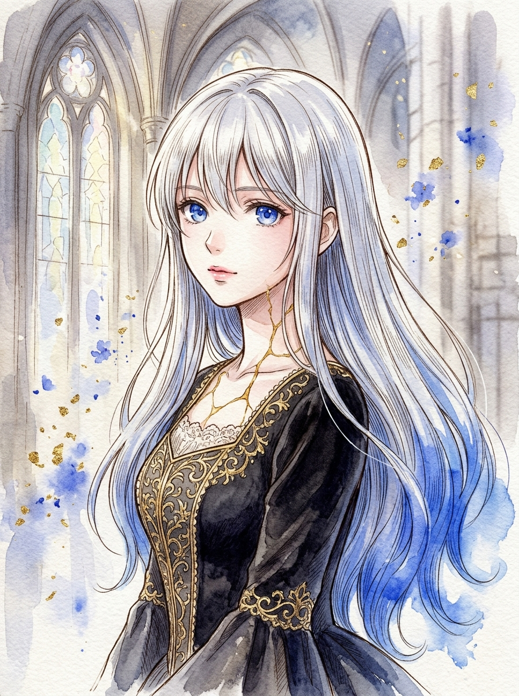
    </td>
    <td width="65%" valign="top">
      <h3>イリス・ラピスラズリ (Iris Lapis-Lazuli)</h3>
      
<b>「わたくしの背中は、貴方のパレットナイフに預けましたわ。――おやりなさい、ルカ！ この偽りの白を、残らず削ぎ落とすのです！」</b>

      <ul>
        <li><b>肩書</b>：生ける聖画（リビング・イコン）『第零聖女：青金石の嘆き』（外見16歳）</li>
        <li><b>武装・能力</b>：<b>【真群青の画装展開（ウルトラマリン・ドライヴ）】</b>、<b>【層位解放（レイヤー・アンカヴァー）】</b></li>
        <li><b>人物像</b>：ボローニャ石膏のごとき白磁の肌、毛先が群青に輝くプラチナブロンド、純度100%のラピスラズリの瞳を持つ少女。鎖骨や手首には金継ぎ状の微細な亀裂（クラクリュール）が走り、背中には「7層のオーバーペイント」が施されている。ルカを「三流修復師」と罵る気位の高い毒舌お嬢様（「〜ですわ」）だが、ルカが焼く甘い卵白のメレンゲ菓子に一瞬で餌付けされる愛嬌を持つ。「自分は人間ではなく造り物の絵具の塊なのではないか」という孤独を抱えながら、最下層（シノピア）の真実を求めてルカに背中を預ける。</li>
      </ul>
    </td>
  </tr>
  <tr>
    <td width="35%" align="center">
      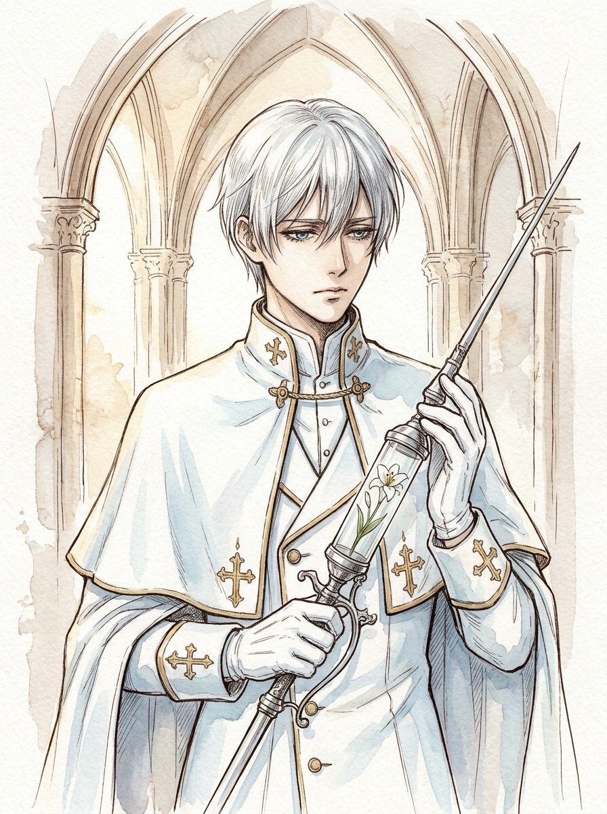
    </td>
    <td width="65%" valign="top">
      <h3>ユリアン・クレムニッツ (Julian Kremnitz)</h3>
      
<b>「修復とは、傷ついた世界に秩序という名の白を与える行為だ。下層にある醜い下絵など、誰も求めてはいない」</b>

      <ul>
        <li><b>肩書</b>：聖彩教会・異端審問修復庁（インクィジシオン・レストウロ）主席執行官（22歳）</li>
        <li><b>武装・能力</b>：長槍型高圧蒸気複合噴霧銃<b>『白亜の断罪（ホワイト・イノセンス）』</b></li>
        <li><b>人物像</b>：ちりひとつない純白（クレムニッツ・ホワイト）の法衣と白い山羊革の手袋を纏う、ルカの元兄弟子。5年前、師ヴェロッキオを教会へ密告した張本人。氷のように冷徹な秩序の番人としてルカの前に立ち塞がるが、その白い手袋の下には、都市の崩壊を防ぐために一人で裏切り者の泥を被った激しい苦悩を隠している。</li>
      </ul>
    </td>
  </tr>
  <tr>
    <td width="35%" align="center">
      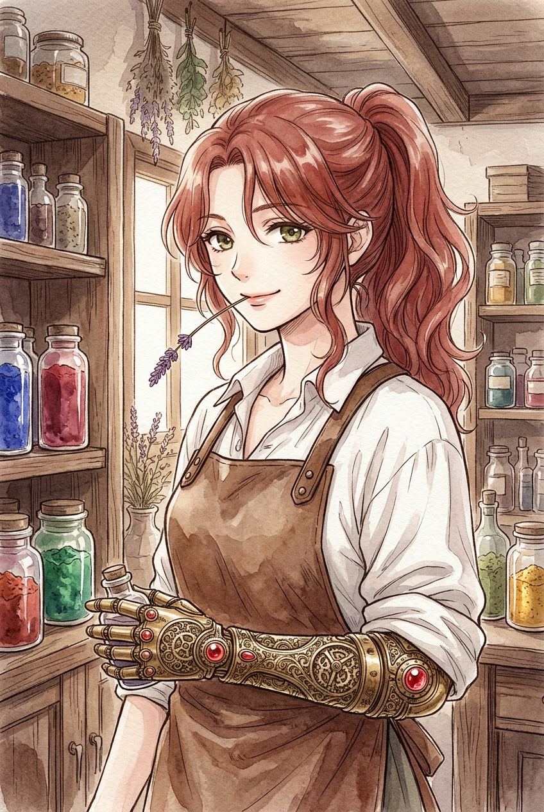
    </td>
    <td width="65%" valign="top">
      <h3>キアラ・ボーロ (Chiara Bolo)</h3>
      
<b>「いいかいお嬢ちゃん、金箔ってのはね、その下に塗られた泥臭い赤土（ボーロ）があるからこそ、あんなに温かく輝くもんさね」</b>

      <ul>
        <li><b>肩書</b>：灰底街の闇画材・劇物商『赤土堂（ボロ・ショップ）』店主（26歳）</li>
        <li><b>特徴・能力</b>：真鍮と赤瑪瑙（ブラッド・アゲート）の職人義手、非合法溶剤・鉱物顔料の精製</li>
        <li><b>人物像</b>：燃えるような赤茶色（テラ・ロッサ）の髪を持ち、煙草代わりに乾燥スパイクラベンダーの茎を咥える豪快な姉御肌。かつて上層ギルドの天才金箔職人だったが、教会の強制労働で家族を失った過去を持つ。ルカの重金属中毒を誰よりも案じ、二人の戦いを裏から支える最高の協力者。</li>
      </ul>
    </td>
  </tr>
  <tr>
    <td width="35%" align="center">
      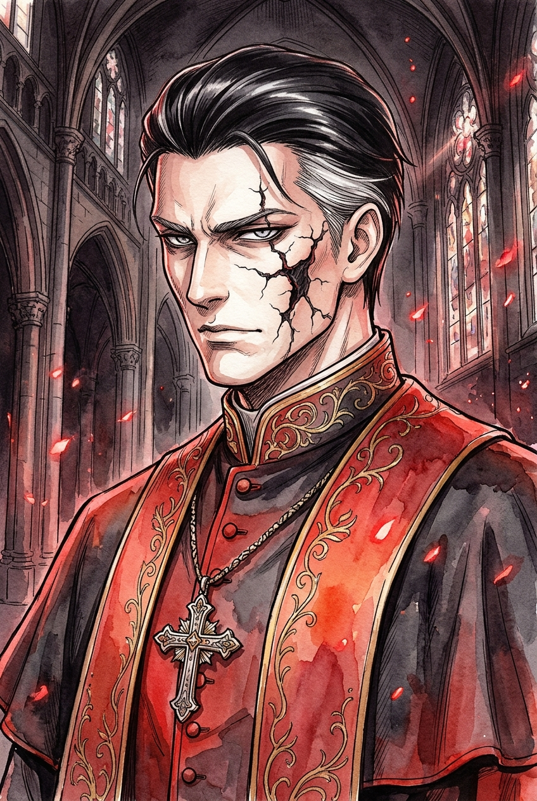
    </td>
    <td width="65%" valign="top">
      <h3>ダンテ・サヴォナローラ (Dante Savonarola)</h3>
      
<b>「灰になれ、異端の筆よ。――画装展開、『断罪の熾天使（セラフ・バーミリオン）』」</b>

      <ul>
        <li><b>肩書</b>：聖彩教会・枢機卿 兼 異端審問修復庁長官（45歳）</li>
        <li><b>武装・能力</b>：特級聖骸画<b>『断罪の熾天使（セラフ・バーミリオン）』</b>、破壊的焼却修復術</li>
        <li><b>人物像</b>：深紅（バーミリオン）と漆黒の枢機卿法衣を纏い、顔の左半分に黒変した辰砂（メタ辰砂）の火傷呪創を刻む最高権力者。「虚栄の焼却」と「白亜の上塗り」によって500年の神話秩序を維持するため、イリスを溶解炉に沈めて大聖堂の天井壁画『創世の大フレスコ』の補修材として永久固定しようと画策する。</li>
      </ul>
    </td>
  </tr>
</table>

<b>🎨 初版アニメキービジュアル＆キャラクターイラスト（v1・デジタル彩色版）ギャラリーを表示</b>

 

  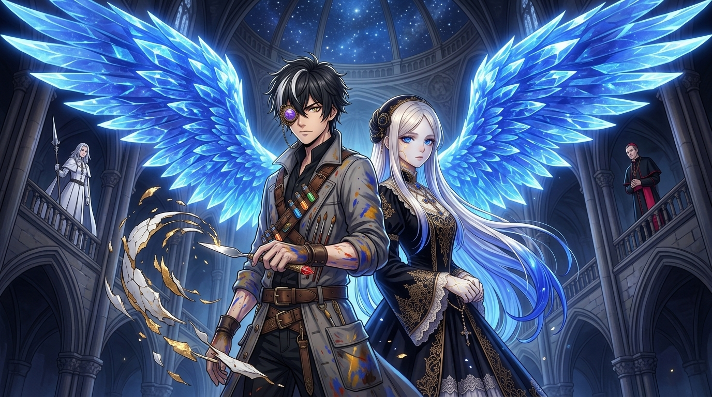
    
  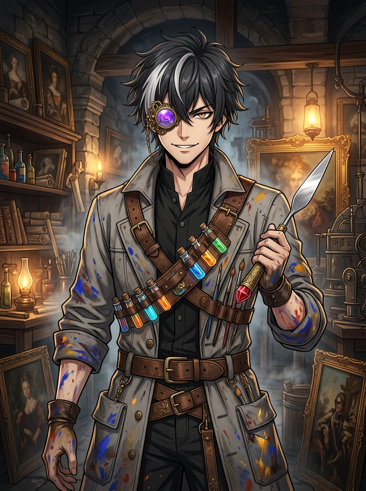
  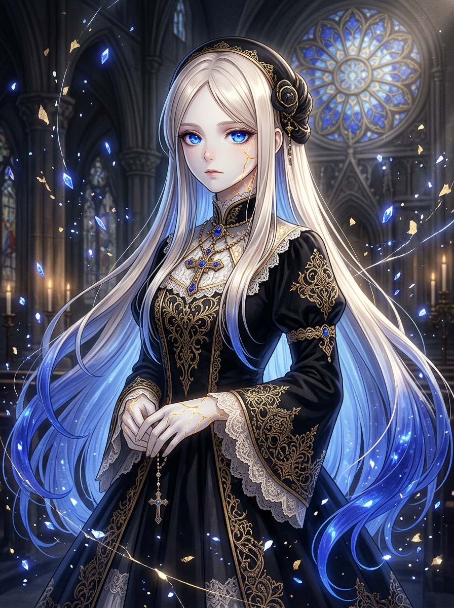
  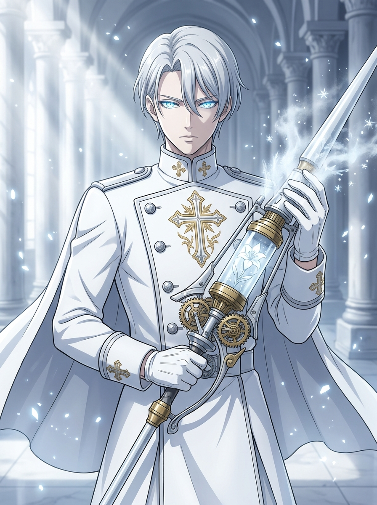
  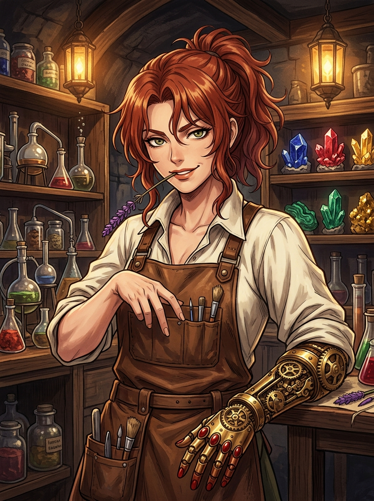
  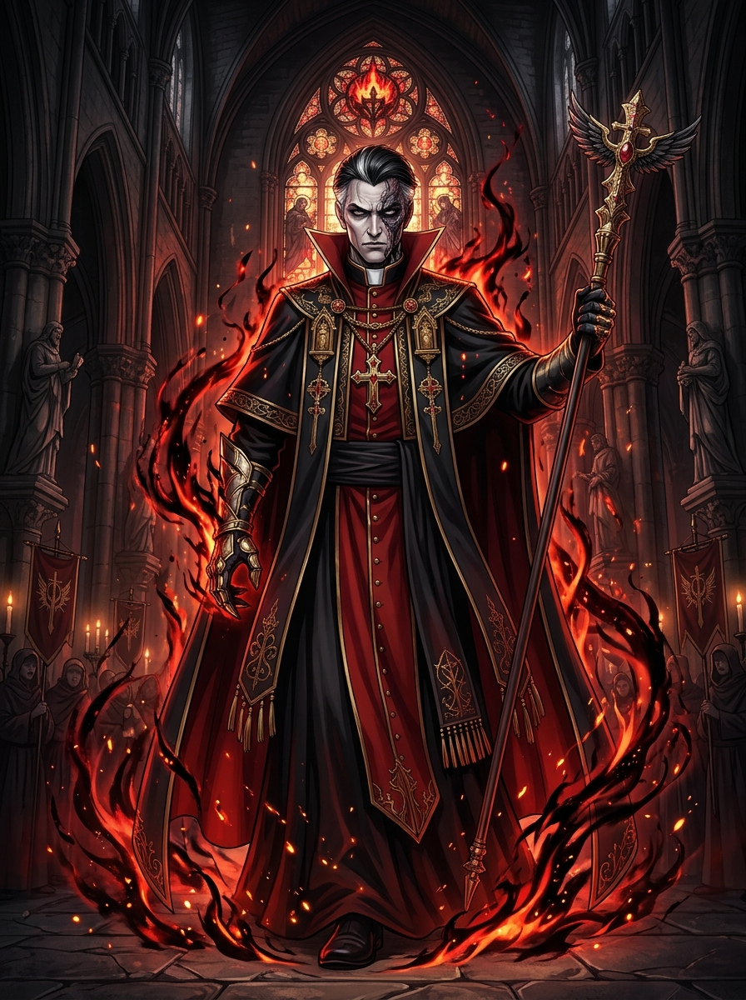

---

## 📚 EPISODES / 本編・全12話エピソード一覧（全話無料公開）

各話のタイトルをクリックすると、小説本編をそのままお読みいただけます。

| 話数 | サブタイトル | 中心となる保存修復科学・見どころ | 文字数 |
| :---: | :--- | :--- | :---: |
| **第1話** | [**『鉛白（クレムニッツ・ホワイト）の棺と群青の少女』**](./chapters/ch01.md) | テレピン油・無水エタノール・氷酢酸による**第1層（ダンマル樹脂＋鉛白）選択的剥離**／イリス覚醒と師匠のモノグラム『V』 | 10,904字 |
| **第2話** | [**『嘆きの聖母画と黒変する辰砂（バーミリオン）』**](./chapters/ch02.md) | 卵白のメレンゲ菓子とバディ契約／**辰砂（$\alpha\text{-HgS}$）の黒変現象と水銀蒸気毒**／ヨウ化カリウム錯体化と表層剥離 | 10,144字 |
| **第3話** | [**『白亜の断罪者と雌黄（オーピメント）の黄金翼』**](./chapters/ch03.md) | 時計塔での兄弟子ユリアン戦／師ヴェロッキオの残酷な真実／**第2層（卵黄テンペラ＋三硫化二ヒ素）剥離**と『蒼穹の双翼』 | 11,115字 |
| **第4話** | [**『真夜中の贋作オークションと紫外線（ブラックライト）の罠』**](./chapters/ch04.md) | 少女人形に変装したイリス／**紫外線蛍光と斜光によるクラクリュール（描き亀裂・焼き亀裂・亀裂流入）の公開真贋鑑定バトル** | 11,280字 |
| **第5話** | [**『石膏（ジェッソ）の墓標と泣き虫な下絵たち』**](./chapters/ch05.md) | ボローニャ石膏廃鉱山の99体の試作体少女像／「お前が流す涙の温度は人間の温度だ！」／**超音波共鳴メスによる第3層（銅石鹸層）剥離** | 12,309字 |
| **第6話** | [**『蜜蝋（エンカウスティック）の記憶と落ちてきた空』**](./chapters/ch06.md) | サヴォナローラ戦／亜硫酸ガスによる群青病／**蜜蝋の融点（65℃）を逆利用した第4・5層同時剥離**／世界の真相とルカの**色覚喪失** | 12,212字 |
| **第7話** | [**『色褪せる視界（モノクローム）と卵白のメレンゲ』**](./chapters/ch07.md) | 白黒（グリザイユ）の朝／**黒焦げのメレンゲを「真っ白だろ？」と差し出すルカと「世界一美しい純白ですわ」と食べるイリス**／涙の投降 | 12,526字 |
| **第8話** | [**『白き籠の鳥と裏切り者のペンティメント』**](./chapters/ch08.md) | 涙で波打つ（コックリング）書き置き／純白の鳥籠でのイリスの誇り／**ランプの熱で「偽証の羊皮紙」の裏から浮かび上がる没食子鉄インクの遺言** | 10,477字 |
| **第9話** | [**『師（マエストロ）の遺言と赤土（ボーロ）の誇り』**](./chapters/ch09.md) | 師の愛ある7層の真意／キアラの平手打ちと『赤瑪瑙バニッシャー』の継承／**光の濃淡と凹凸で視る『明暗法（キアロスクーロ）視覚』の開眼** | 10,196字 |
| **第10話** | [**『兄弟子の白、修復師の黒』**](./chapters/ch10.md) | 硫化水素による鉛白弾幕の黒変粉砕／大理石階段でのユリアンとの一騎打ち／**『白百合のイコン』表層0.3ミリ剥離と師匠の下絵開示** | 8,918字 |
| **第11話** | [**『金箔の下の赤土（ボーロ）――第六層剥離』**](./chapters/ch11.md) | 溶融鉛の処刑台からの空中救出／**卵白リゾチーム酵素と赤瑪瑙共鳴による第6層（純金箔＋赤土ボーロ）剥離**／最下層シノピアの素顔 | 12,657字 |
| **第12話** | [**『大天蓋・剥離転写（グラン・ストラッポ）――嘘つきパレットが描く明日』**](./chapters/ch12.md) | **直径100mの偽りの神話天井を引き剥がす『大天蓋・剥離転写』**／蘇る群青色／**贋作核で神話を騙しイリスを人間に解放するタイトル回収＆大団円** | 13,014字 |

---

## 🗂️ 公式設定資料（`notes/`）

本作の世界をより深く味わうための世界観および登場人物設定を公開しています。

- **[`notes/world.md`](./notes/world.md)**: 世界観・三層都市構造・聖骸彩術（古典絵画の5層構造・顔料の化学特性と毒性・修復技術）の体系定義
- **[`notes/characters.md`](./notes/characters.md)**: 登場人物の詳細設定・口調ルール・アニメ公式ビジュアル仕様書（カラーパレット・シルエット・表情指定）

> 💡 **【制作裏側・ネタバレ設定資料について】**  
> 全体の三幕構成・全12話詳細プロット、伏線管理シート、各話4シーン設計書（全48シーン）、AI完全自律執筆マニュアル等の【制作裏側アーカイブ】は、全編読了者限定特典および公式ファンブック（有料ブログ等）にて限定公開予定です。
